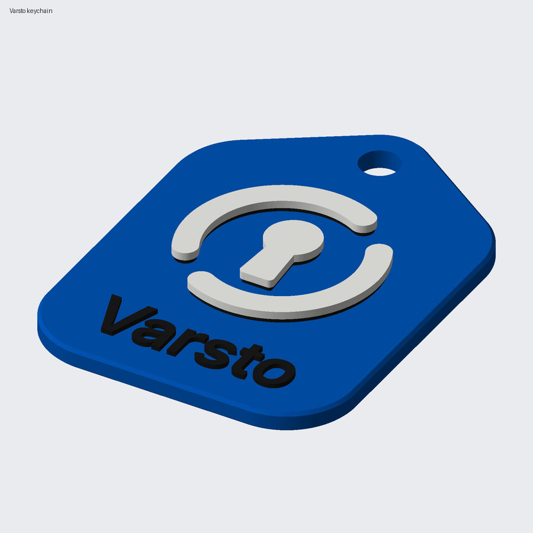

# Varsto 3D-printable fan items

Logo merchandise for a Bambu Lab P1S with an AMS (0.4 mm nozzle, PLA). The
models are generated from the brand geometry in `../render.py`: the same ring
arcs, keyhole and Inter SemiBold wordmark as the SVG files, not traced pixels.
Every colour is a separate part of one object, so the print comes out as one
piece and the AMS changes the colour.



## Items

Times and grams are Bambu Studio 2.08.02.61 command-line estimates for the
projects as committed (0.20 mm Standard, Textured PEI plate). Grams include
the filament that is purged on each colour change.

| Item | File | Size (mm) | Colours | Changes | Time | Blue / white / black (g) |
| --- | --- | --- | --- | --- | --- | --- |
| Keychain tag | `varsto-keychain.3mf` | 40 x 55 x 4.0 | 3 | 2 | 18 min | 4.83 / 1.03 / 0.40 |
| Keychain tag, no text | `varsto-keychain-2colour.3mf` | 40 x 48 x 4.0 | 2 | 1 | 16 min | 4.56 / 0.87 / – |
| Coaster | `varsto-coaster.3mf` | 95 x 95 x 5.0 | 3 | 8 | 54 min | 24.29 / 2.67 / 0.87 |
| Coaster, no text | `varsto-coaster-2colour.3mf` | 95 x 95 x 5.0 | 2 | 4 | 46 min | 23.88 / 2.40 / – |
| Fridge magnet (2 magnets) | `varsto-magnet.3mf` | 88 x 36 x 5.2 | 3 | 2 | 23 min | 8.52 / 1.00 / 0.50 |
| Fridge magnet, no text (1 magnet) | `varsto-magnet-2colour.3mf` | 50 x 50 x 4.6 | 2 | 1 | 18 min | 6.49 / 1.05 / – |
| Desk standee, plate 1: tile | `varsto-standee.3mf` | 60 x 67 x 4.2 | 2 | 1 | 22 min | 9.20 / 1.26 / – |
| Desk standee, plate 2: base with black text | `varsto-standee.3mf` | 90 x 42 x 10.8 | 2 | 1 | 27 min | 16.00 / – / 0.26 |
| Desk standee, plate 2: base with white text | `varsto-standee-2colour.3mf` | 90 x 42 x 10.8 | 2 | 1 | 28 min | 16.00 / 0.77 / – |
| Badges: pin back + magnet (one plate) | `varsto-badge.3mf` | 2 x (30 x 30 x 4.0) | 2 | 1 | 17 min | 4.64 / 0.92 / – |

Notes per item:

- **Keychain**: the tag continues below the logo square to make room for the
  wordmark (cap height 6.4 mm, strokes about 1.1 mm). The ring lug at the top
  is a solid 3.5 mm ring around a 5 mm hole, as thick as the whole body.
  Both hole edges have a 0.4 mm chamfer so a split ring slides in. The
  no-text version is the plain 40 mm logo tile with the same lug.
- **Coaster**: this one is printed **face down**. The textured plate becomes
  the top surface, and the white glyph (0.8 mm) and the black wordmark
  (0.6 mm, cap 9 mm) are a flush inlay in the first layers, so a cup stands
  flat. The edges have chamfers of 1.0 mm (top) and 0.6 mm (bottom). The
  underside, which faces up while printing, has a 1.0 mm recess (83 x 83 mm,
  15 mm corners) for a self-adhesive cork or felt sheet. Because every inlay
  layer holds two or three colours, this item has the most colour changes, and
  the prime tower is switched on for it.
- **Fridge magnet**: the mark and the wordmark side by side. Two 10 x 2 mm
  magnets are embedded during a pause (see below). The no-text version is a
  50 mm logo tile with one magnet.
- **Desk standee**: two plates in one project. Plate 1 is the 60 mm logo tile
  with a 30 x 7 mm tab. Plate 2 is the base, which has a slot leaning back 12°
  and the wordmark (cap 11 mm) raised 0.8 mm on the front. Push the tab into
  the slot. The clearance is 0.3 mm per side; add a drop of glue if the fit is
  loose. Printing the parts on separate plates keeps each plate to one colour
  change.
- **Badges**: a 30 mm logo tile, 3.0 mm body plus a 1.0 mm raised glyph. One
  has a 22.5 x 6.2 x 1.0 mm groove on the back for a glue-on pin back
  (20–22 mm bar). The other has a 10.3 x 2.2 mm pocket for a 10 x 2 mm magnet
  (glue it in from the back). The badges have **no wordmark**: at 30 mm the
  text would need a cap height under 5 mm beside or below a glyph that already
  fills the tile. Putting it on the back would need two- or three-colour
  inlay layers, which isn't worth the purge for a hidden face.
- **Bookmark**: not included. A raised design rubs the pages, and a flush
  inlay at bookmark thickness needs a colour change on almost every layer.

All items print without supports, flat on the plate. The smallest first-layer
contact is the 30 mm badge at 712 mm². Nothing has separate small feet or
islands on the first layer.

## How the colours are layered

The light colours sit in the top layers only, so the AMS changes colour
rarely:

- **Two colours** (blue + white): the blue body, then the white glyph raised
  1.0 mm (5 layers). This is one filament change per print.
- **Three colours** (keychain, magnet): the blue body, then 0.6 mm (3 layers)
  holding the black wordmark *and* a black underlay under the glyph, then the
  white glyph 1.0 mm (5 layers) on top. The order is blue -> black -> white,
  which is **two filament changes** for the whole print. The underlay is inset
  0.25 mm so the white top covers most of it. From the side it shows as a thin
  dark line under the glyph, like a shadow. The two-colour variants exist if
  you'd rather not have it.
- **Coaster**: a flush inlay printed face down (see above), so there are 8
  changes in the first 4 layers and then blue only.

The white is at least 0.8 mm (4 layers) thick everywhere, so the colour under
it doesn't show through PLA Basic Jade White.

## Filaments and AMS slots

| AMS slot | Part | Default filament | Bambu code | Hex (Bambu) |
| --- | --- | --- | --- | --- |
| 1 | tile / body | PLA Basic Cobalt Blue | 10604 | #0056B8 |
| 2 | glyph | PLA Basic Jade White | 10100 | #FFFFFF |
| 3 | wordmark | PLA Basic Black | 10101 | #000000 |

The projects use the system preset "Bambu PLA Basic @BBL P1S 0.4 nozzle" in
all three slots. When you print, Bambu Studio asks which AMS tray each
filament comes from; map slot 1 -> blue, 2 -> white, 3 -> black. If a
two-colour project has no black part, slot 3 is simply unused.

**Matte option**: PLA Matte Charcoal (11101) is also listed as #000000. It
gives a softer black with less shine, and PLA Matte Ivory White (11100) pairs
with it. If you use them, change the slot presets to "Bambu PLA Matte @BBL P1S
0.4 nozzle".

**Contrast**: black on Cobalt Blue has low contrast (the WCAG ratio is about
3:1). The raised letters cast their own edge shadows, but the black wordmark
on blue reads best from up close. The brand uses ink (#16181d) only on light
backgrounds. If you want the name to stand out more, use the white-text
standee or the two-colour items.

### Colour match to the brand

ΔE is CIEDE2000 from the sRGB hex values. Under about 2 the difference is hard
to see, and around 5 it is a clearly similar shade. All values are
approximate: printed PLA never matches a screen colour exactly.

| Brand colour | Candidate | Source of the hex | Hex | ΔE |
| --- | --- | --- | --- | --- |
| Signal blue #2b57d6 (tile) | **Bambu PLA Basic Cobalt Blue** 10604 | Bambu Studio `filaments_color_codes.json` | #0056B8 | 5.6 |
| | Bambu PLA Translucent Blue 13611 | same | – | 6.3 |
| | Bambu PLA Lite Blue 16601 | same | – | 7.6 |
| | Bambu PLA-CF Royal Blue 14601 | same | – | 8.2 |
| | SUNLU PLA Matte "Matte Blue" | product photo on store.sunlu.com, approximate | ≈ #4d65c5 | ≈ 5.4 |
| | SUNLU High Speed PLA / HS PLA+ "Klein Blue" | product photo, approximate | ≈ #2d45cd | ≈ 5.7 |
| | SUNLU PLA Matte "Matte Klein Blue" | product photo, approximate | ≈ #253dc5 | ≈ 8.1 |
| | SUNLU PLA / PLA+ / PLA+ 2.0 "Klein Blue" | product photo, approximate | ≈ #1a25b0 | ≈ 14.7 |
| Vault blue #1b3a9a (darker option) | **Bambu PLA Basic Blue** 10601 | Bambu Studio `filaments_color_codes.json` | #0A2989 | 5.2 |
| | Bambu PLA-CF Royal Blue 14601 | same | – | 3.5 |
| | Bambu PETG HF Blue 33600 | same | – | 3.6 |
| | SUNLU PLA Matte "Matte Klein Blue" | product photo, approximate | ≈ #253dc5 | ≈ 6.3 |
| | SUNLU PLA / PLA+ / PLA+ 2.0 "Klein Blue" | product photo, approximate | ≈ #1a25b0 | ≈ 7.1 |
| Glyph #ffffff | **Bambu PLA Basic Jade White** 10100 | Bambu Studio | #FFFFFF | 0 |
| Ink #16181d (wordmark) | **Bambu PLA Basic Black** 10101 | Bambu Studio | #000000 | 6.1 |
| | Bambu PLA Tough Black 12101 | Bambu Studio | #25282A | 5.5 |

About the SUNLU values: SUNLU doesn't publish colour codes. These hex values
were sampled from the colour images in the store.sunlu.com product data
(median of the coloured area; highlights and shadows dropped). Treat them as
±5 ΔE. One colour name can also cover different shades: "Klein Blue" samples
as #1a25b0 on the PLA/PLA+ pages and #2d45cd on the High Speed pages.

SUNLU sells no "Navy" or "Dark Blue" PLA. The nearest is the Refill PLA/PLA+
"Midnight Black (dark navy blue)", ≈ #1e2538, which is too dark (ΔE ≈ 17.5
to Vault blue). Bambu Studio 2.08 ships these SUNLU presets that list the P1S
0.4 nozzle: SUNLU PLA+, PLA+ 2.0, PLA Matte, Silk PLA+, Marble PLA, Wood PLA
and PETG (all named "@BBL X1C"). There is no preset for plain SUNLU PLA or
High Speed PLA; use the PLA+ or Generic PLA preset for those. When you use
SUNLU filament, change the slot's preset in Bambu Studio. The geometry doesn't
change.

**Darker tile**: `python3 generate.py --tile vault --out <dir>` writes the same
projects with PLA Basic Blue (#0A2989) as the slot 1 colour. The colour only
affects the preview in Bambu Studio; the AMS mapping decides what is actually
printed. Note that `brand/README.md` says the tile is Signal blue; a darker
tile is a fan-item liberty.

## Print settings

All three slots use the 0.20 mm Standard process from the P1S system presets
(`p1s-project-settings.json`), on the Textured PEI plate. Every height in the
models is a multiple of 0.2 mm, so each colour boundary falls exactly on a
layer. Per-object changes:

| Item | Changes from 0.20 mm Standard |
| --- | --- |
| keychain | 3 walls, 25 % infill (the lug takes the load) |
| magnet, standee tile, badges | 3 walls |
| coaster | 4 top layers (they are the hidden underside), prime tower on |

The prime tower is switched off for the raised-glyph items. They have only
one or two colour changes, and the P1S purges into its chute. The flushing
volumes are set by hand (in mm³, rows "from", columns "to"; order blue, white,
black):

```
          blue  white  black
blue         0    560    160
white      220      0    140
black      320    680      0
```

Changing from blue or black to white needs the most purge, otherwise the
first white layer comes out tinted. You can press *Flushing volumes ->
Auto-calculate* in Bambu Studio to use its own estimate instead. To save
filament on the coaster, enable *Flush into objects' infill* for it; the
infill is hidden.

## Embedding the magnets (fridge magnet)

You need 10 x 2 mm round neodymium magnets: two for `varsto-magnet.3mf`, one
for `varsto-magnet-2colour.3mf`. The pockets are 10.3 mm across and 2.2 mm
deep, with 0.6 mm of plastic below them (the side that touches the fridge).

1. The project already has a pause at layer 15 (Z 3.0 mm). In Bambu Studio's
   preview you can see it on the layer slider. The printer stops after
   finishing the pocket walls (top at Z 2.8 mm), before the layer that closes
   the pockets.
2. When the printer pauses, drop a magnet into each pocket. Polarity doesn't
   matter on a fridge. If you're making several, put them in the same way up
   so they stack.
3. Press each one down flat with a non-metal tool (a toothpick or a plastic
   spudger). It must sit below the pocket rim, or the nozzle will catch it.
   A tiny drop of glue stops a magnet from jumping to the steel nozzle as it
   passes over.
4. Resume the print from the printer screen or Bambu Handy.

If the magnets are a tight fit, raise `POCKET_D` in `generate.py` (or
scale the pocket in the slicer) and regenerate. The badge magnet pocket opens
at the back, so no pause is needed there: glue the magnet in after printing.

## Files

| Path | What |
| --- | --- |
| `varsto-*.3mf` | Bambu Studio projects: P1S 0.4 nozzle, PLA Basic presets, parts assigned to AMS slots 1–3, pause and per-object settings included |
| `stl/varsto-<item>-<colour>.stl` | one STL per colour part for other slicers. All the parts of an item share one coordinate system: load them together (PrusaSlicer, OrcaSlicer: answer *yes* to "load as a single object with multiple parts") and assign a filament per part |
| `previews/*.png` | renders of each item (the coaster is shown face up, the standee assembled) |
| `summary.json` | sizes, first-layer contact area and part volumes written by `generate.py` |
| `generate.py` | the parametric generator |
| `p1s-project-settings.json` | Bambu Studio project settings: the P1S, 0.20 mm Standard and 3 x PLA Basic system presets, flattened |
| `make_settings.py` | rebuilds `p1s-project-settings.json` from a Bambu Studio install |
| `slice.py` | slices every project with the Bambu Studio command line and prints time, grams, colour changes, pauses and warnings |

For other slicers, recreate the magnet pause yourself: add a pause before the
layer at Z 3.0 mm (layer 15 at 0.2 mm layers with a 0.2 mm first layer).

## Regenerate

```sh
uv venv /path/to/venv
uv pip install --python /path/to/venv/bin/python manifold3d numpy fonttools uharfbuzz pillow
/path/to/venv/bin/python generate.py              # all items, into this directory
/path/to/venv/bin/python generate.py --only coaster
```

Plain `pip install` in a virtual environment works too. The output is
deterministic: the same code gives byte-identical 3MF files.

Optional, if you have Bambu Studio (an extracted AppImage, `--appimage-extract`)
and `xvfb-run`:

```sh
/path/to/venv/bin/python make_settings.py /path/to/squashfs-root   # refresh the embedded presets
/path/to/venv/bin/python slice.py /path/to/squashfs-root --work /tmp/varsto-slice
```

The main dimensions are constants at the top of each item function in
`generate.py`: tile size, body height, text cap height, pocket size and so on.

## Trademark

The Varsto name and logo are trademarks of the Varsto project; see
[TRADEMARK.md](../../TRADEMARK.md). The source code licence does not grant
rights to them. The trademark policy doesn't mention merchandise, so read
these files as **fan items for personal, non-commercial use**:

- Print them for yourself and your friends.
- Don't sell them, and don't use them to promote a product, service or event.
- Don't present them as official or endorsed project merchandise.

Some items bend the rules in `brand/README.md` on purpose:

- The coaster has text inside the tile.
- The magnet's mark-to-text ratio differs from the lockup.
- The glyph has a black underlay.
- There is an optional darker tile.

Use the brand files in `brand/`, not these models, for anything official.
